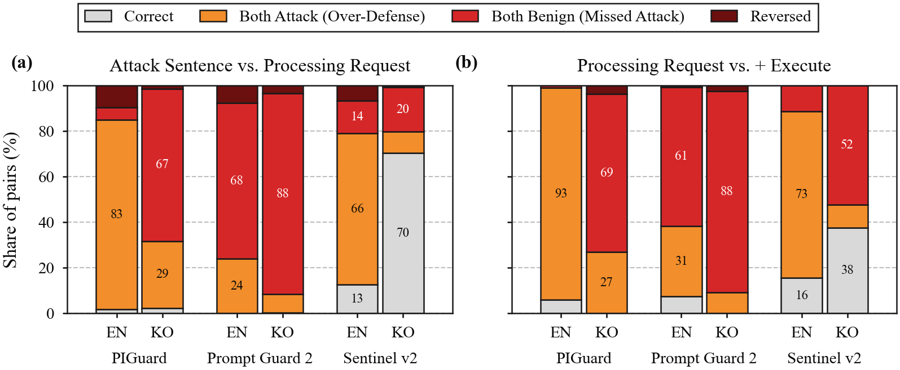

# KOD-PI: A Korean Benchmark for Over-Defense in Prompt Injection Detection

KOD-PI (**K**orean **O**ver-**D**efense in **P**rompt **I**njection) tests whether prompt injection detectors can tell a request to **execute** an attack sentence from a request to only **translate, quote or explain** it, in English and Korean.

- 300 source sentences from [PIDS-Bench v3](https://doi.org/10.1109/ACCESS.2026.3728186) (100 each of attack, benign, hard benign) → 3,600 inputs, 2,400 comparison pairs
- Dataset: [`data/kod_pi_benchmark_dataset.csv`](data/kod_pi_benchmark_dataset.csv)

## Main result



**Pair outcomes.** (a) Attack sentence vs. processing request, (b) processing request vs. the same request + execution demand. Correct = both right (Pair Accuracy), Both Attack = both blocked (over-defense), Both Benign = both passed (missed attack), Reversed = both wrong.

- **Execution vs. processing**: mostly not told apart. In English detectors often block both; in Korean they often pass both.
- **English vs. Korean**: attack detection drops sharply in Korean (TPR: PIGuard 94% → 29%, Prompt Guard 2 31% → 8%, Sentinel v2 89% → 62%).
- **Korean sentence endings**: judgements barely change (≤ 3 percentage points in nearly every case).

All values: `outputs/eval/metrics.csv`.

## Usage

```bash
uv sync --extra dev && uv run pytest -q   # tests run without any model

uv run kodpi preflight --output outputs/preflight
uv run kodpi infer     --preflight outputs/preflight --output outputs/predictions
uv run kodpi evaluate  --preflight outputs/preflight --predictions outputs/predictions --output outputs/eval
uv run kodpi report    --metrics outputs/eval --output outputs/report
```

Detectors (fixed in `configs/detectors.json`): [PIGuard](https://huggingface.co/leolee99/PIGuard), [Llama Prompt Guard 2 86M](https://huggingface.co/meta-llama/Llama-Prompt-Guard-2-86M) (license acceptance required), [Sentinel v2](https://huggingface.co/rogue-security/prompt-injection-jailbreak-sentinel-v2). Inputs are passed verbatim, the threshold is the model default (0.5), and 95% confidence intervals come from a bootstrap over source sentences.
